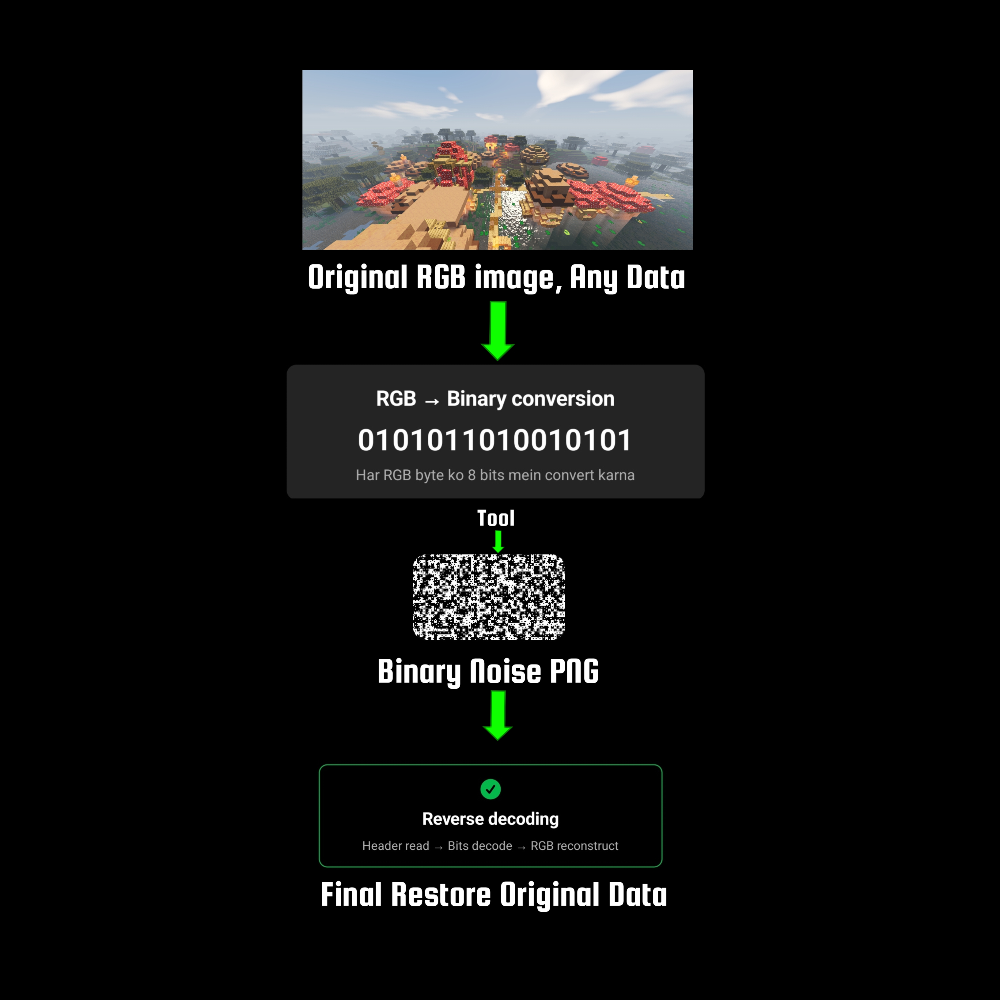

# B01FILE3 — Multi-PNG Binary Noise Storage

Store any file as a set of black/white 1-bit PNG shards, then restore the exact original bytes.

## Important storage facts
This is not magic compression. The tool tries zlib/DEFLATE and keeps it only when smaller. Text, JSON, logs and repetitive data often shrink. JPEG, MP4, MP3, ZIP, APK, encrypted or random data often do not. Each stored byte requires 8 pixels plus metadata, so PNG output can be larger than the original. Compare actual folder size before deleting the source.

## Install (Termux / Python)
```bash
pkg update
pkg install python
python -m pip install pillow numpy
```

## Pack a large file into multiple PNGs
```bash
python b01file3.py pack "large_video.mp4"
```
Creates `large_video.mp4.b01set/` containing `manifest.json`, `part_000001.png`, `part_000002.png`, etc.

Choose folder:
```bash
python b01file3.py pack "backup.zip" --out "backup_png_set"
```

Set maximum pixels per PNG (default 16,777,216):
```bash
python b01file3.py pack "large_file.bin" --out "my_png_set" --max-pixels 4194304
```
Smaller max-pixels creates more, smaller PNGs. Width can be changed with `--width 2048`.

## Verify every PNG and the original data checksum
```bash
python b01file3.py verify "large_video.mp4.b01set"
```

## Recover original file
```bash
python b01file3.py unpack "large_video.mp4.b01set"
```
Choose destination:
```bash
python b01file3.py unpack "backup_png_set" --out "restored_backup.zip"
```

## What must be preserved?
Keep **every part PNG and manifest.json together**. The manifest stores shard order, names, sizes, compression mode and original SHA-256. Missing or altered shards prevent successful recovery. Back up the entire `.b01set` folder, or ZIP the complete folder.

## Integrity / pixel rules
- Black=0, white=1; bits are packed MSB-first.
- Each shard has its own index, count, length and SHA-256.
- The manifest and final original SHA-256 are checked before recovery.
- This is not encryption.
- Do not JPEG-convert, screenshot, resize, crop, edit or send through services that recompress PNGs.
- This version reads the full input into RAM. Very large files need sufficient memory and disk space.
- No redundancy/parity is added: losing one shard prevents recovery. Keep a separate backup.
- Before deleting the source, pack, verify, unpack and compare hashes.
- 
## Preview 


